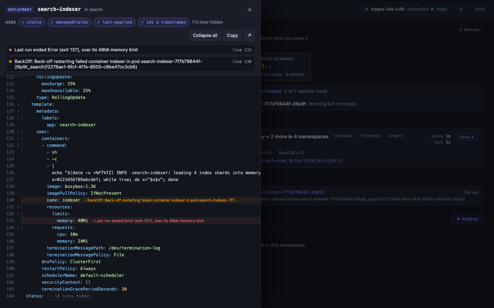
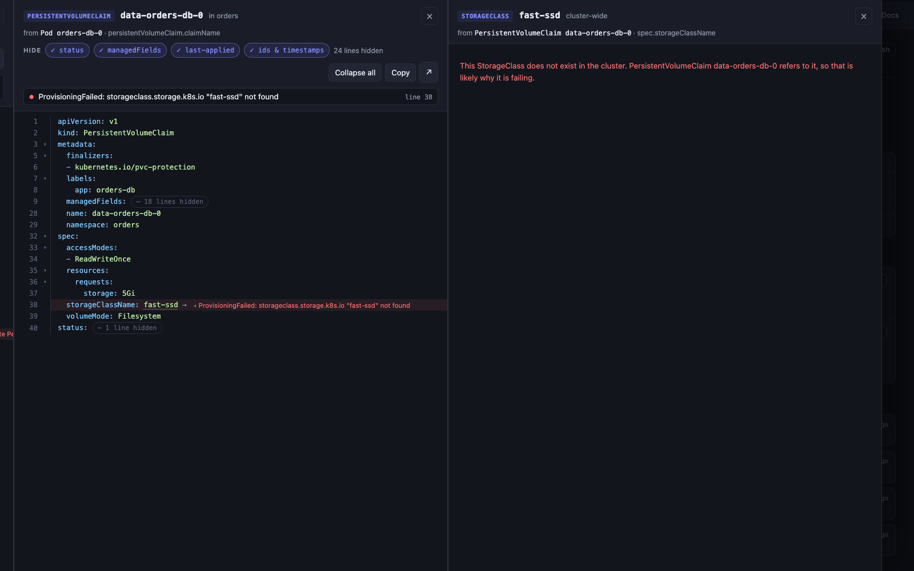
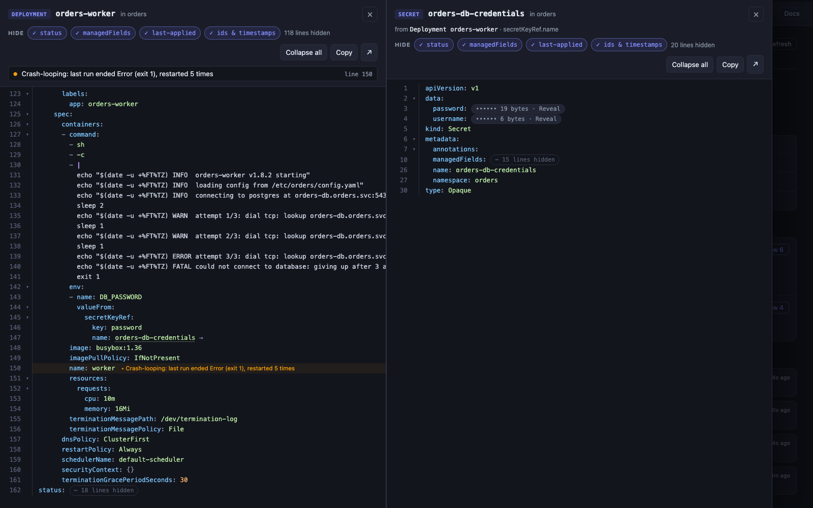

# KubeHealth

Local, read-only k8s triage. One binary on your laptop, pointed at your kubeconfig. Shows what's broken, not a wall of events.

[](docs/demo.mp4)

[Website & benchmark explorer](https://clglavan.github.io/kubehealth/) · [Full-quality video](docs/demo.mp4) · [Releases](https://github.com/clglavan/kubehealth/releases) · [Try it on kind](demo/README.md)

## Screenshots


**Overview.** One row per broken workload, ranked new / ongoing / chronic. The brief says where to start, the model adds a note on the top problem.

| | |
|---|---|
|  |  |
| **Namespace status.** Live counts and what needs attention. | **Object.** Ownership chain, events, actions. |
|  |  |
| **Logs inline**, previous run included for crash loops. | **RCA.** The model reads the evidence, calls tools for more. |
|  |  |
| **Contexts** grouped by environment, switched in place. | **Prod** gets a red stripe. |
|  |  |
| **Cluster-wide**: Nodes and PVs. | **Docs**: every feature traced through the system. |



**YAML that points at the problem.** The fields the object's warnings and container state blame are highlighted with the reason, listed on top, and scrolled to. `status`, `managedFields` and other noise are hidden until you ask.

| | |
|---|---|
|  |  |
| **Follow references** column by column: Pod → PVC → a StorageClass that doesn't exist. | **Secrets** stay masked until you reveal one key. |

## How it handles events

```
Kubernetes API  (active context only)
    │  one worker, ≤ 1 list call every 2 s, QPS 5 / burst 10
    │    every 10 s  → Warning events, cluster-wide (fieldSelector=type=Warning)
    │    other ticks → stalest namespace, all events
    ▼
event cache (per cluster)
    │
    ├── Overview
    │     ├─ group    each warning walked up to its owner
    │     │             Pod → ReplicaSet → Deployment
    │     │             Pod → Job → CronJob
    │     │             Pod → StatefulSet / DaemonSet / operator CR
    │     │           names = free first guess, ownerReferences confirm
    │     │           (≤ 2 GET/s, cached 30 min) → one problem per root
    │     ├─ age      new < 2 h · ongoing 2–24 h · chronic > 24 h
    │     │           idle after 15 min quiet
    │     │           CronJobs: status.lastSuccessfulTime (run events expire ~1 h)
    │     ├─ merge    one pattern across namespaces if started within 10 s,
    │     │           same workload + reason, or same infra reason in 3+ ns
    │     │           (pull secrets, scheduling, mounts…), never across tiers
    │     ├─ cascade  warnings at 2+ levels and every leaf failing → ▲
    │     ├─ brief    computed, no model: start here · new · linked · old
    │     └─ AI note  top problem's events + container state + ≤ 30 log lines,
    │                 rewritten only when the top problem changes
    │
    ├── Namespace view ──► live snapshot, 7 list calls, cached 30 s
    ├── Logs ────────────► GetLogs, current run + previous run
    ├── Correlate ───────► cache only, events ±5 min across namespaces
    ├── YAML ────────────► live object; highlights the fields its warnings blame,
    │                        references open to the right, Secrets stay masked
    ├── Link-follow ─────► objects the evidence names: claim → StorageClass,
    │                        unreachable Service → its Pods, missing keys, nodes
    ├── ✦ AI ────────────► events + describe + container state + logs + linked → model
    └── RCA ─────────────► same, plus tools the model can call:
                             get_pod_logs · get_object_describe
                             get_object_events · get_correlated_events
```

## Install

Grab a binary from [releases](https://github.com/clglavan/kubehealth/releases):

| | |
|---|---|
| `kubehealth_*` | macOS, Linux, Windows. AI via LM Studio / Ollama, or off |
| `kubehealth-embed_*_darwin_arm64` | Apple Silicon, model + `llama-server` bundled (~600 MB) |

**Regular**

```bash
tar -xzf kubehealth_v0.3.0_darwin_arm64.tar.gz && cd kubehealth_v0.3.0_darwin_arm64
xattr -d com.apple.quarantine kubehealth     # macOS, not notarized
./kubehealth                                 # http://localhost:8080
```

**Embed** (AI offline, no setup)

```bash
tar -xzf kubehealth-embed_v0.3.0_darwin_arm64.tar.gz && cd kubehealth-embed_v0.3.0_darwin_arm64
xattr -d com.apple.quarantine kubehealth-embed
./kubehealth-embed                           # starts the bundled model on a free local port
```

First run unpacks the model to `~/Library/Caches/kubehealth/embedded` (~650 MB).

## Usage

```bash
./kubehealth -namespaces default,monitoring             # only these namespaces
./kubehealth -kubeconfig ~/.kube/staging.yaml -port 9090
AI_ENABLED=false ./kubehealth                           # no AI
LMSTUDIO_MODEL=qwen/qwen3-4b-2507 ./kubehealth          # your own model in LM Studio
LMSTUDIO_URL=http://localhost:1234/v1 ./kubehealth-embed  # embed build, skip the bundled model
./kubehealth -version
```

| env | default |
|---|---|
| `LMSTUDIO_URL` | `http://localhost:1234/v1` |
| `LMSTUDIO_MODEL` | `qwen/qwen3-4b-2507` |
| `AI_ENABLED` | `true` |
| `AI_LINK_FOLLOW` | `true` |
| `KUBECONFIG` | `~/.kube/config` |

## AI

- **Note** on the top problem, on the overview
- **✦ AI**: one-shot analysis of an object or namespace, streamed
- **RCA**: agent loop with tools (`get_pod_logs`, `get_object_describe`, `get_object_events`, `get_correlated_events`)
- **Link-following**: before asking, KubeHealth reads the objects the evidence names (a claim and its StorageClass, the Service a log line can't reach and its Pods, missing ConfigMap or Secret keys, the nodes of a scheduling failure, pull secrets) and adds them to the prompt. Off with `AI_LINK_FOLLOW=false`.
- Plain questions, no required answer format: what's wrong, the evidence, the fix, how sure. Prompts fit the model's context.

[magos-k8s-0.6b](https://huggingface.co/clglavan/magos-k8s-0.6b) is a small model I'm training for KubeHealth; the embed build bundles it. v19 names the right root cause in 88% of the [KubeHealth-Bench](bench/README.md) incidents and, with link-following, finds a cause that sits in another object 78% of the time. It only sees what KubeHealth hands it; it suggests, you decide.

`kubehealth bench` replays recorded incidents through the AI features with no cluster, to compare models: [bench/README.md](bench/README.md).

## RBAC

Read-only. The built-in `view` ClusterRole covers it, plus `list` on `nodes` and `persistentvolumes` for the cluster-wide view. Link-following also reads `storageclasses` and `secrets` (key names only, never values) when allowed; without them that evidence is left out.

## Try it without a cluster

```bash
./demo/setup.sh                            # 2 broken kind clusters, ~3 min
./kubehealth -kubeconfig demo/kubeconfig
./demo/teardown.sh
```

## Build

Go 1.25+.

```bash
make build           # ./kubehealth
make embed           # ./kubehealth-embed (downloads model + llama-server; model pinned by MAGOS_REVISION)
make release         # archives for every platform in dist/
make release-embed   # embed archive for this machine
```

More: [docs/reference.md](docs/reference.md) (every button, API, architecture).
