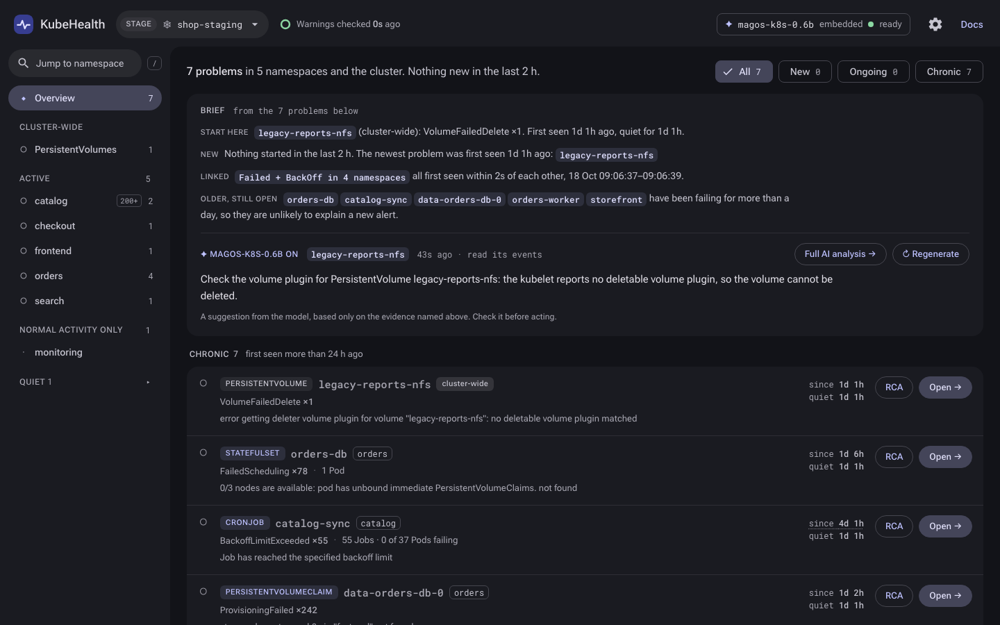
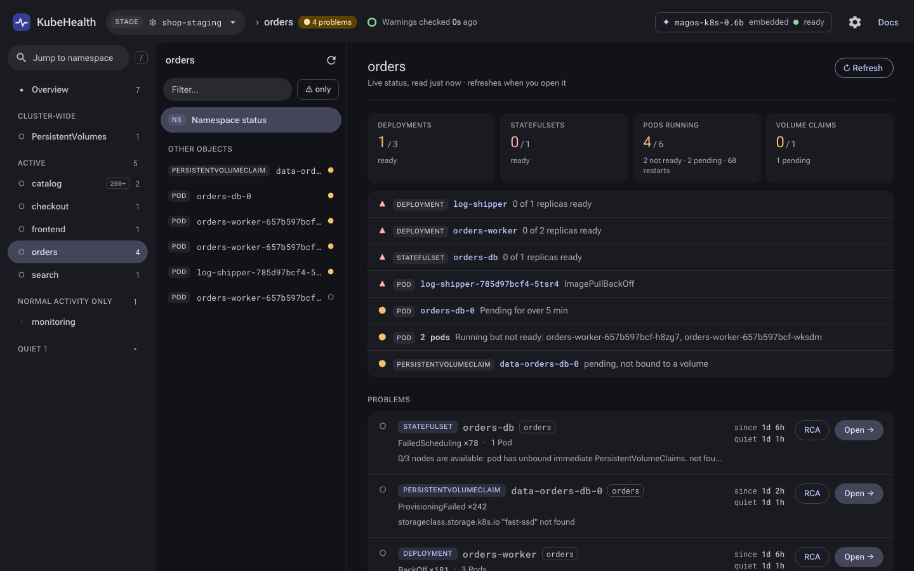
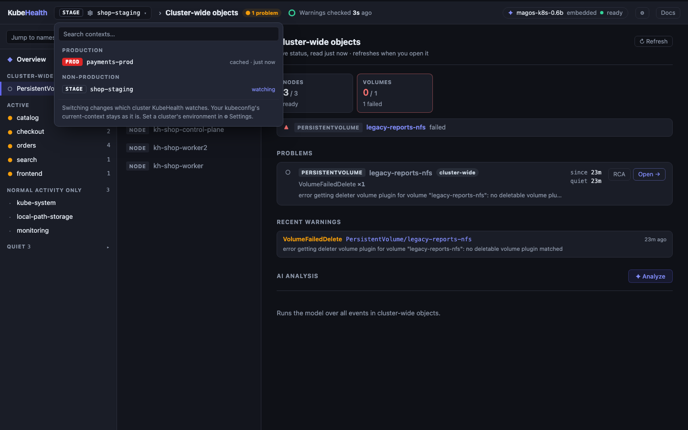
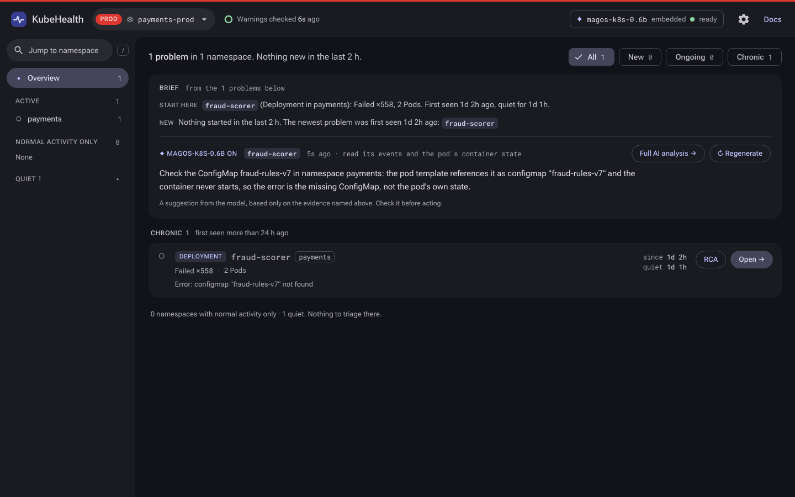
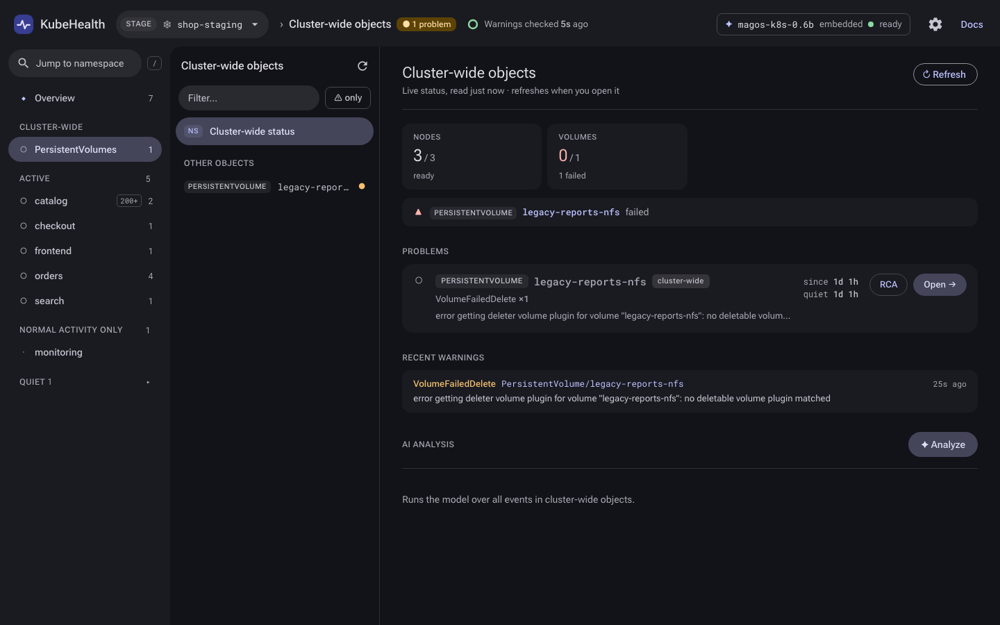
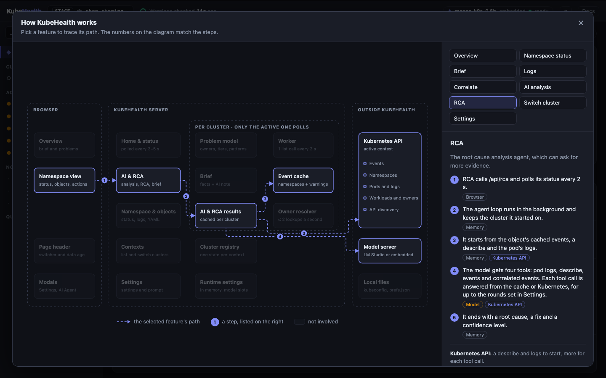
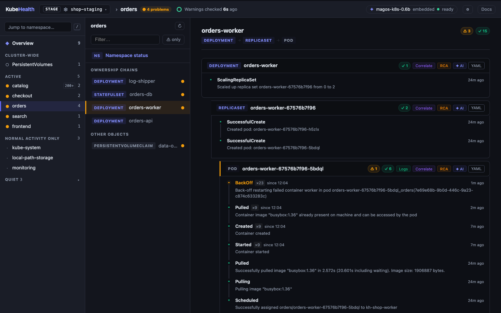
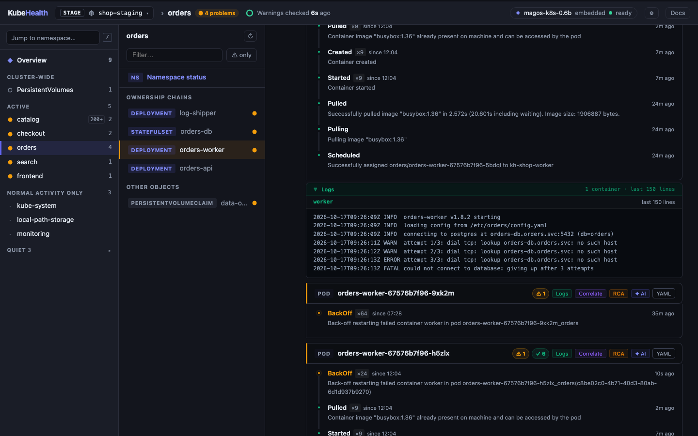
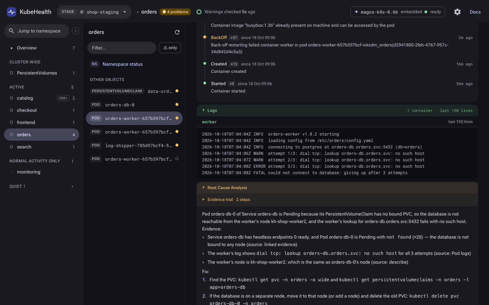

# KubeHealth reference

The details behind the [README](../README.md): how problems are built, what each button does, configuration, the API and the code layout.

- [The UI](#the-ui)
- [Actions on an object](#actions-on-an-object)
- [AI and RCA](#ai-and-rca)
- [Configuration](#configuration)
- [Building and releasing](#building-and-releasing)
- [API](#api)
- [Architecture](#architecture)

## The UI



- **Three panes** — the namespace rail on the left is always there. Its first item, **Overview**, shows the brief and the ranked problems. Pick a namespace and the middle pane lists its objects while the right pane shows the namespace's status; pick an object and the right pane shows that object. Moving between namespaces and objects swaps the panes in place without reloading the page, and the URL follows along (`/namespace/<ns>?focus=Kind/name`), so links, Back and Forward work. Below 1100 px wide the rail folds behind a button; below 760 px the panes stack.
- **Triage overview** — one row per failing workload rather than per event, ranked into **New** (first seen < 2 h ago), **Ongoing** (2–24 h) and **Chronic** (> 24 h). Rows show occurrences (the sum of each event's `count`), when the problem started and when it last fired. A row turns idle after 15 min without a new occurrence. The page updates in place every 3 s.



- **Namespace status** — the first entry in a namespace's object list. It shows a live snapshot (Deployments, StatefulSets and DaemonSets ready, CronJobs with failing or suspended ones, Jobs, Pods by phase and restarts, volume claims) and lists what needs attention: workloads not fully ready, CronJobs whose last run failed, pods grouped by why they are unhealthy. Below that are the namespace's problems from the overview, its most recent warnings, and the AI analysis button. The snapshot costs seven list calls when you open the namespace and is cached for 30 s (↻ Refresh fetches it again). The cluster-wide entry shows Nodes ready and PersistentVolumes by phase instead.
- **Owner grouping** — failing Pods, Jobs and ReplicaSets are grouped under their workload (CronJob, Deployment, DaemonSet, StatefulSet or an operator's CR). Names give a first guess for free, then a background resolver confirms one member per problem through `ownerReferences`, walking up to the top of the chain (at most two GETs per second, only while there is something to confirm; answers cached 30 min). For CronJobs it also reads `status.lastSuccessfulTime`, because each run's events expire after about an hour and would otherwise make a long-failing CronJob look new.
- **Patterns** — problems in different namespaces are merged into one row when they started within 10 s of each other, share a workload name and reason, or share an infrastructure reason (pull secrets, scheduling, mounts, …) in 3+ namespaces. Problems in different tiers are never merged.
- **Brief** — a few sentences above the problem list: where to start, what started in the last 2 h, which problems look linked, what is cluster-wide and what is old. They are computed from the problem list, not written by a model, so they are always accurate, appear instantly and work with AI turned off. Every problem they mention is a chip that jumps to its row.
- **AI note on the top problem** — the model reads the most urgent problem's events plus up to 30 log lines from its newest failing pod (stack frames dropped, error lines kept first, trimmed to a quarter of the loaded context) and suggests what to check first. The note names the model and the evidence it read, links to the full AI analysis, and is rewritten only when the top problem changes (after 30 s, so a flapping ranking doesn't keep the model busy). It never takes a model slot you need: if you start an AI analysis or RCA while it runs, it stops and retries later. Tested on the bundled 0.6B model, asking for a summary of several problems at once produced invented links between them every time, so the model is only ever given one problem and its own evidence.
- **Cluster-wide scope** — events about cluster-scoped objects (Nodes, PersistentVolumes) get their own row and their own page (`/namespace/_cluster`) instead of counting against `default`, where Kubernetes records them
- **Namespace rail** — searchable list (press `/`, Enter opens the first match) with active namespaces first, normal-only next, and quiet namespaces folded away. Each namespace shows its problem count and is highlighted while open.
- **Cluster switching** — the context button in the header lists every kubeconfig context, grouped by environment, and switches the watched cluster in place. Only the active cluster is polled, so API load doesn't grow with the number of clusters. Clusters you switch away from stay in memory: switching back is instant, and tabs still open on them keep working against that cluster (they show a banner saying their data stopped updating). KubeHealth never changes your kubeconfig's current-context.
- **Cluster identity** — every page shows the context and an environment tag read from its name (`prod`, `nprd`, `stg`, `dev`, `kind-…`; non-production words are checked first, so `nprd` isn't mistaken for `prd`). Production gets a red stripe across the top of every page. Names that don't say show `?`; pick the environment in ⚙ Settings and it's saved in `prefs.json` under your user config directory (`~/Library/Application Support/kubehealth/` on macOS). The header also shows how old the warning data is and the AI model's status.
- **Ownership chain detection** — links related objects (Deployment → ReplicaSet → Pod, CronJob → Job → Pod, StatefulSet → Pod, DaemonSet → Pod) using naming conventions; zero extra API calls
- **Cascade failure detection** — flags a chain red when the root and all leaf members have warnings
- **Object list + detail** — the object list has search and a warnings-only filter; the detail pane shows the full event timeline for the selected object. Repeated events show when they started (`×23 · since 11:01`) as well as when they last fired. The list uses the overview's marks: ▲ cascade, ● warning, ○ idle.
- **Deep links** — overview rows open `/namespace/<ns>?focus=Kind/name`, selecting that object (or, for a CronJob without events of its own, its newest failing Job). The row's RCA button adds `&rca=1&pod=<newest failing pod>` and starts the analysis on arrival; the AI note's link does the same with `&ai=1`.
- **Object describe** — click any object name to see live spec, status, conditions, and labels; supports built-in types and all CRDs via dynamic API discovery
- **Rate-limit-safe fetching** — single background worker makes at most one list call every 2 s. Every 10 s that call is one cluster-wide list of Warning events (`fieldSelector=type=Warning`, filtered by the API server); the other ticks refresh the stalest namespace's full event list. `QPS=5 / Burst=10` cap on the k8s REST client. When cluster-wide listing is forbidden, or `-namespaces` is set, warnings come from the namespace sweep alone.

| | |
|---|---|
|  |  |
|  |  |

## Actions on an object



Every object in the namespace view shows its counts, then the same buttons in the same order: Logs (Pods only) · Correlate · RCA · ✦ AI · YAML.

| Button | What it does | K8s API? | LLM? |
|--------|-------------|----------|------|
| **Logs** | Fetches the last N container log lines. Tries the current run first, then `Previous=true` (covers CrashLoopBackOff). | ✅ | ❌ |
| **Correlate** | Scans the in-memory event cache across **all** namespaces for events whose timestamp falls within ±5 min of the selected object's events. | ❌ | ❌ |
| **RCA** | Multi-step agent loop — sends events + describe + pod logs to the LLM with 4 tools; model calls tools iteratively until confident, then produces a structured Root Cause + Resolution + Confidence. | ✅ | ✅ |
| **AI** | Single-shot analysis: streams events + describe + pod logs to the LLM and shows tokens as they arrive. | ✅ | ✅ |

Results are collapsible panels (expanded by default, except Correlate which is collapsed). AI and RCA results persist server-side — refreshing the page reconnects to a still-running analysis.

| | |
|---|---|
|  |  |

## AI and RCA

- **Streaming responses** — regular AI uses `stream: true`; tokens update the UI every 300 ms via server-side cache polling
- **Streaming cursor** — a blinking `▋` appears while tokens are arriving; the panel style is identical before and after completion (no visual jump)
- **RCA agent loop** — up to N iterations (configurable); the model can call `get_pod_logs`, `get_object_describe`, `get_object_events`, and `get_correlated_events` as tools
- **Initial context** always includes events + object describe + pod logs (including previous-run logs for crashed pods). For a workload (Deployment, StatefulSet, DaemonSet, Job, CronJob), whose own events rarely say what is wrong, it also includes the warnings of the ReplicaSets, Jobs and Pods it owns (at most 12) and the logs of its newest failing Pod.
- **Container state** — above the logs, one line per container says how often it restarted, how its last run ended and what it is waiting on (`exit code 137, SIGKILL: usually out of memory, memory limit 48Mi`). An OOMKilled container rarely logs anything about it, so without this line the model can't tell. The overview's AI note gets the same line.
- **Low temperature** — analysis runs at 0.3 and RCA at 0.2 (servers default to about 0.8): both read evidence, and a small model wanders off it at higher temperatures.
- **Formatting** — results render `**Label**:` sections, bullet and numbered lists, inline code and fenced code blocks
- **Context overflow detection** — if LM Studio returns a 400 with the "Trying to keep the first N tokens" message, the UI shows a clear "increase your context length" guide instead of hanging
- **Concurrent call limit** — configurable max simultaneous requests to LM Studio; excess requests are rejected immediately. The overview's AI note only uses a free slot and hands it over when you start an analysis.
- **Page-refresh safe** — all analysis goroutines run against `context.Background()` and survive browser navigation
- **Cluster-safe** — an analysis keeps the cluster it was started on, even if you switch while it runs, and results are cached per cluster, so `default` on one cluster never shows another cluster's analysis

### Settings (⚙)
| Setting | Effect |
|---------|--------|
| Log Lines | Lines fetched by Logs button and included in AI / RCA context |
| LLM Timeout | Minutes before giving up — large objects like Elasticsearch need 5–10 min for prompt processing |
| Max Concurrent Calls | Prevents overloading a single-GPU local model |
| RCA Max Iterations | Tool-calling rounds before the agent is forced to conclude |

### AI Agent (✦)
- Edit the **system prompt** that is injected as the `system` role message on every AI analysis and RCA call. The overview's AI note uses its own stricter prompt (use only the given facts and log lines, don't guess causes), because the analysis prompt asks for root causes and tempts a small model to invent one.
- Live **context window estimate** — shows system prompt + events + logs + tool definitions as % of `loaded_context_length` (fetched from LM Studio's `/api/v0/models`)
- **Response format** is hardcoded in the user message (Summary / Issues / Actions) and cannot be broken by the system prompt
- **Reset to default** restores the initial system prompt

### Docs
Pick a feature to see its path through the system (browser, server, per-cluster state, Kubernetes, the model) as numbered steps, with what it costs the API and the model.

## Configuration

### Flags
| Flag | Default | Description |
|------|---------|-------------|
| `-port` | `8080` | HTTP listen port |
| `-kubeconfig` | `~/.kube/config` | Path to kubeconfig |
| `-namespaces` | *(all)* | Comma-separated namespace list |
| `-version` | | Print the version and exit |

### Environment variables
All AI settings can be overridden at startup:

| Variable | Default | Description |
|----------|---------|-------------|
| `LMSTUDIO_URL` | `http://localhost:1234/v1` | LM Studio OpenAI-compat base URL |
| `LMSTUDIO_MODEL` | `qwen/qwen3-4b-2507` | Model identifier |
| `AI_ENABLED` | `true` | Set to `false` or `0` to disable AI features |
| `AI_SYSTEM_PROMPT` | *(built-in SRE prompt)* | Default system prompt |
| `KUBECONFIG` | `~/.kube/config` | Path to kubeconfig; a colon-separated list of files is merged as kubectl does |

Runtime settings (log lines, timeout, max calls, RCA iterations) are configured in the UI under ⚙ Settings and take effect immediately without restart.

### LM Studio setup

1. Download and install LM Studio
2. Load a model — **qwen/qwen3-4b-2507** is the tested default
3. Start the local server (default: `http://localhost:1234`)
4. For large objects (Elasticsearch, etc.) increase the model's **Context Length** via the gear icon → Context Length → Reload — 8192 or 16384 tokens recommended

## Building and releasing

`make release` cross-compiles the regular build for macOS, Linux and Windows into `dist/`, and `make release-embed` packages the embedded build for the machine you run it on. Both stamp the version from `git describe` (see `kubehealth -version`).

`make embed` is shorthand for `make fetch-assets && make build-embed`. The fetch step pulls the GGUF from [HuggingFace](https://huggingface.co/clglavan/magos-k8s-0.6b) (override with `MODEL_URL=...` for a different quantization, or `MODEL_SRC=/path/to.gguf` to use a local file) and downloads a matching `llama-server` from [llama.cpp releases](https://github.com/ggerganov/llama.cpp/releases). Both go into `embedded/` (gitignored) and get pulled in via `//go:embed`.

The embedded binary extracts its bundled assets to `~/Library/Caches/kubehealth/embedded/` on first run, spawns `llama-server` on a free local port, and points the rest of the app at it. Setting `LMSTUDIO_URL` skips the embedded server and falls back to the regular flow.

## API

### Data
| Endpoint | Description |
|----------|-------------|
| `GET /api/home` | Overview data: ranked problems, patterns, brief, rail counts, data age, model status |
| `GET /api/snapshot/{ns}[?refresh=1]` | Live namespace snapshot (`_cluster` for Nodes and PVs), cached 30 s |
| `GET /fragment/namespace/{ns}` | The namespace's object list and detail panes as HTML, swapped in by the page |
| `GET /api/status` | `{"loaded": N, "total": M, "ready": bool}` — namespace loading progress |
| `GET /api/events` | Full dashboard data JSON |
| `GET /api/object/{ns}/{kind}/{name}` | Live object describe (built-in types and CRDs) |

### Clusters
| Endpoint | Description |
|----------|-------------|
| `GET /api/contexts` | Kubeconfig contexts with environment tags; re-read on every call |
| `POST /api/context` | Switch the watched cluster: `{"name": "..."}` |
| `POST /api/context/env` | Set a context's environment: `{"name": "...", "env": "prod"}` (`""` reads it from the name) |

Every page sends `X-KubeHealth-Context` with its API calls, so a tab keeps talking to the cluster it was opened on after you switch elsewhere.

### AI
| Endpoint | Description |
|----------|-------------|
| `POST /api/ai/analyze/{ns\|object}/{…}` | Trigger AI analysis for a namespace or object |
| `GET /api/ai/insights/{ns\|object}/{…}` | Poll AI result (`partial`, `content`, `error`) |
| `POST /api/ai/brief` | Rewrite the overview's AI note now |
| `GET /api/ai/config` | Read system prompt + LM Studio model info |
| `POST /api/ai/config` | Update system prompt |

### RCA
| Endpoint | Description |
|----------|-------------|
| `POST /api/rca/{ns}/{kind}/{name}` | Start RCA agent loop |
| `GET /api/rca/status/{ns}/{kind}/{name}` | Poll RCA state (`iteration`, `steps[]`, `result`) |

### Logs & Correlate
| Endpoint | Description |
|----------|-------------|
| `GET /api/logs/{ns}/{pod}` | Pod logs with Previous fallback |
| `GET /api/correlate/{ns}/{kind}/{name}` | Cross-namespace correlated events |

### Settings
| Endpoint | Description |
|----------|-------------|
| `GET /api/settings` | Read runtime settings |
| `POST /api/settings` | Update log lines, timeout, max calls, RCA iterations |

## Architecture

```
main.go          — HTTP server, routing, template rendering, per-cluster worker
cluster.go       — Per-context cluster state, switching, environment tags, saved preferences
ai.go            — AI streaming (callLMStudio, streamLMStudio), insight cache
ai_config.go     — System prompt store, LM Studio model-info fetch (/api/v0/models)
rca.go           — RCA agent loop, tool dispatcher, RCA state store
problems.go      — Overview problem model: owner groups, tiers, cascades, patterns, /api/home, /api/status
brief.go         — The brief: computed facts plus the AI note on the top problem, /api/ai/brief
owners.go        — Owner inference from names + background ownerReferences resolver
warnings.go      — Cluster-wide Warning event feed, merged into every namespace's events
snapshot.go      — Live namespace snapshot (workloads, pods, volume claims), cached 30 s, /api/snapshot
correlate.go     — Cross-namespace event correlation (pure cache read)
logs.go          — Pod log fetching with Previous-run fallback
settings.go      — Runtime settings (log lines, timeout, max calls, RCA iterations)

rca_test.go, problems_test.go, brief_test.go, logs_test.go — unit tests (go test ./...)
demo/            — kind clusters with realistic failures, for trying KubeHealth locally

templates/
├─ header.html         — Shared header: cluster switcher, data age, model status, stale-tab banner
├─ app.html            — The page shell: namespace rail, overview (brief, ranked problems), in-place navigation, live updates from /api/home
├─ ns_view.html        — Namespace panes: object list, status panel, detail panels, all action buttons, JS agent functions
├─ ai_modal.html       — AI Agent config modal (system prompt, context window estimate)
├─ settings_modal.html — Settings modal (log lines, timeouts, concurrency, RCA iterations)
├─ docs_modal.html     — Interactive architecture diagram with animated data flows
└─ object.html         — YAML viewer
```

### Data flow summary

```
Kubernetes API (the active context; each context has its own caches below)
    │  Worker, one list call every 2 s:
    │    every 10 s → cluster-wide Warning events  ──► warnFeed
    │    otherwise  → stalest namespace, all events ──► nsCache
    ▼
namespaceEvents() = nsCache merged with warnFeed  ◄──── feeds everything below
    │
    ├── Home (/api/home)  ──► problems.go groups warnings by owner
    │                           ├──► owners.go confirms owners (≤ 2 GET/s, cached)
    │                           └──► brief.go: facts + AI note on the top problem
    │                                (events + pod log lines → LM Studio, free slot only)
    │
    ├── Namespace view  (object list from the merged cache, read-only)
    │       └──► snapshot.go: 7 list calls on open, cached 30 s
    │
    ├── Correlate  ──► scans the merged cache, zero K8s API call, zero LLM
    │
    ├── Logs  ──► K8s GetLogs (current + Previous fallback)
    │
    ├── AI Analysis  ──► merged cache + K8s describe + K8s logs
    │                        │
    │                        └──► LM Studio (stream=true, SSE)
    │                                 │ tokens every 300 ms
    │                                 ▼
    │                          aiInsightCache  ◄── browser polls 500 ms
    │
    └── RCA Agent  ──► merged cache + K8s describe + K8s logs (initial context)
                            │
                            └──► LM Studio (stream=false, with tools)
                                      │ tool_calls response
                                      ├─ get_object_events      → merged cache
                                      ├─ get_correlated_events  → merged cache
                                      ├─ get_object_describe    → K8s API
                                      └─ get_pod_logs           → K8s API
                                      │ (loops up to maxIter)
                                      ▼
                                 RCA State  ◄── browser polls 2 s
```

### Ownership detection rules

All detection uses Kubernetes naming conventions only (zero API calls):

| Child kind | Suffix pattern | Parent kind |
|------------|---------------|-------------|
| Pod | `-<5-char alphanum>` (from RS) | ReplicaSet |
| Pod | `-<5-char alphanum>` (from Job) | Job |
| Pod | `-<5-char alphanum>` (from DS) | DaemonSet |
| Pod | `-<digits only>` | StatefulSet |
| ReplicaSet | `-<6–12 char alphanum hash>` | Deployment |
| Job | `-<8–10 digit unix-minutes>` | CronJob |

### CRD support

`kindToGVR` first checks a static map of built-in types (fast path), then falls back to `client.Discovery().ServerGroupsAndResources()` which queries the API server for all installed CRDs. Results are cached in a `sync.Map`; the first request for an unknown kind pays the discovery cost, subsequent requests are instant.

## Dependencies

- `k8s.io/client-go` v0.35 — Kubernetes REST client
- `k8s.io/api` / `k8s.io/apimachinery` v0.35 — Kubernetes API types
- `sigs.k8s.io/yaml` — YAML marshalling

All HTML templates are embedded into the binary via `//go:embed templates/*.html`. No external frontend build step is required.
